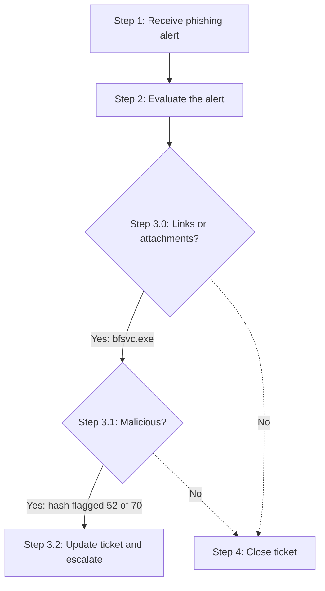
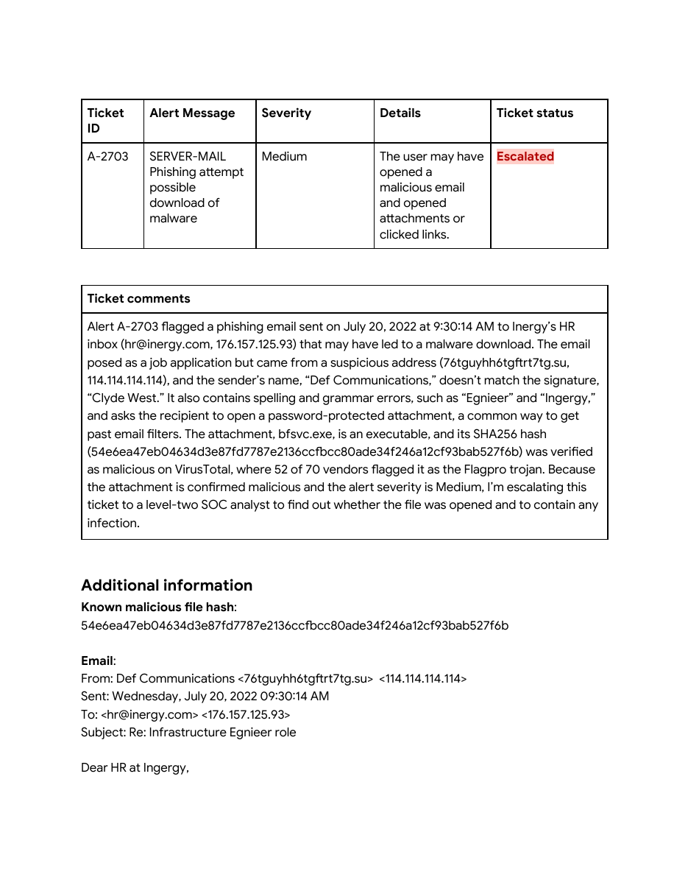
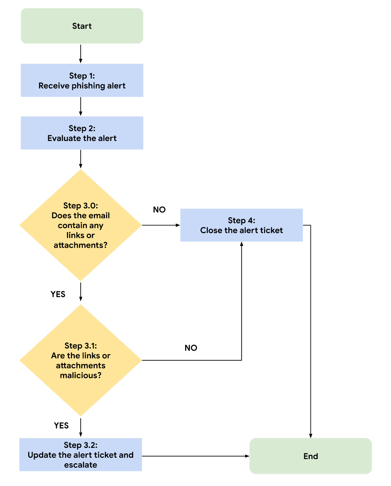

# Phishing Alert Triage: Escalating Ticket A-2703

## Summary
A course activity where I worked a phishing alert ticket from start to finish using a phishing incident response playbook. I evaluated the email, confirmed its attachment was malicious, and escalated the ticket to a level-two SOC analyst with a written summary of my findings.

## My Role
I reviewed the alert ticket and email details, answered the 5 W's of the incident, followed the playbook's decision steps, and updated the ticket's status and comments. The malicious verdict on the attachment comes from my own VirusTotal lookup of the same hash in a previous activity ([virustotal-pyramid-of-pain](https://github.com/john-danko-cyber/virustotal-pyramid-of-pain)). The ticket, email, and playbook were provided by the course.

## Project Overview

This project documents the "Use a playbook to respond to a phishing incident" activity from the Google Cybersecurity Certificate (Sound the Alarm: Detection and Response). The goal was to practice following an organization's playbook to triage an alert quickly and consistently, and to decide whether to close or escalate it.

---

## Scenario

As a level-one SOC analyst at a financial services company, I received a phishing alert about a suspicious file downloaded on an employee's computer. The email attachment's file hash had already been verified as malicious, and my job was to follow the playbook, finish the investigation, and resolve the alert ticket.

| Field | Value |
|---|---|
| Ticket ID | A-2703 |
| Alert message | SERVER-MAIL Phishing attempt possible download of malware |
| Severity | Medium |
| Sender | "Def Communications" `<76tguyhh6tgftrt7tg.su>`, IP `114.114.114.114` |
| Recipient | `hr@inergy.com`, IP `176.157.125.93` |
| Sent | Wednesday, July 20, 2022, 9:30:14 AM |
| Subject | Re: Infrastructure Egnieer role |
| Attachment | `bfsvc.exe` (password protected, password given in the email body) |
| SHA256 | `54e6ea47eb04634d3e87fd7787e2136ccfbcc80ade34f246a12cf93bab527f6b` |

---

## Tools Used

- **Phishing incident response playbook and flowchart** (provided by the course)
- **VirusTotal** (hash reputation, from my previous activity)

---

## The 5 W's

| Question | Answer |
|---|---|
| **Who** | An unknown threat actor posing as a job applicant named "Clyde West." The display name ("Def Communications"), the signature ("Clyde West"), and the random `.su` sender address don't match each other. |
| **What** | A phishing email posing as a job application was sent to Inergy's HR inbox with a password-protected attachment, `bfsvc.exe`, whose hash is verified malicious. The recipient may have opened it. |
| **When** | Wednesday, July 20, 2022, at 9:30:14 AM. |
| **Where** | Inergy's HR department inbox (`hr@inergy.com`, `176.157.125.93`), flagged by the mail server alert. |
| **Why** | The attacker disguised the email as a resume, which HR expects to receive from strangers, and password-protected the file so email filters couldn't scan it. Phishing awareness training may also have been lacking. |

---

## Following the Playbook

1. **Evaluate the alert.** Severity is Medium, which the playbook says may require escalation. The sender details don't match, the message has spelling and grammar errors ("Egnieer," "Ingergy," "I am writing for to express"), and it asks the reader to open a password-protected file.
2. **Step 3.0: Links or attachments?** Yes. The email carries `bfsvc.exe`, an executable posing as a resume and cover letter.
3. **Step 3.1: Malicious?** Yes. The SHA256 hash was flagged by 52 of 70 vendors on VirusTotal as the Flagpro trojan.
4. **Step 3.2: Escalate.** I set the ticket status to **Escalated** and wrote up my findings for a level-two SOC analyst.

---

## Ticket Comments (as submitted)

> Alert A-2703 flagged a phishing email sent on July 20, 2022 at 9:30:14 AM to Inergy's HR inbox (hr@inergy.com, 176.157.125.93) that may have led to a malware download. The email posed as a job application but came from a suspicious address (76tguyhh6tgftrt7tg.su, 114.114.114.114), and the sender's name, "Def Communications," doesn't match the signature, "Clyde West." It also contains spelling and grammar errors, such as "Egnieer" and "Ingergy," and asks the recipient to open a password-protected attachment, a common way to get past email filters. The attachment, bfsvc.exe, is an executable, and its SHA256 hash (54e6ea47eb04634d3e87fd7787e2136ccfbcc80ade34f246a12cf93bab527f6b) was verified as malicious on VirusTotal, where 52 of 70 vendors flagged it as the Flagpro trojan. Because the attachment is confirmed malicious and the alert severity is Medium, I'm escalating this ticket to a level-two SOC analyst to find out whether the file was opened and to contain any infection.

The completed ticket is in [`ticket/`](ticket) as DOCX and PDF, and the course playbook is in [`playbook/`](playbook).

---

## Screenshots

### 1. Completed alert ticket, status Escalated

### 2. Phishing playbook flowchart (provided by the course)

---

## Skills Demonstrated

- Triaging a phishing alert by following a written playbook and flowchart
- Spotting phishing indicators: mismatched sender details, typos, an executable posing as a document, and a password-protected attachment
- Using threat intelligence (a verified file hash) to support an escalation decision
- Organizing incident details with the 5 W's
- Writing clear, evidence-based ticket comments for a level-two analyst

---

## What I Learned

- A playbook keeps triage fast and consistent, since every analyst follows the same decision points and knows when to close or escalate.
- Password-protected attachments are a red flag on their own, because they stop email security tools from scanning what's inside.
- Attackers tailor the lure to the target. Sending a "resume" to HR works because opening attachments from strangers is a normal part of that job.
- Good ticket comments state what happened, the evidence, and the reason for the decision, so the next analyst doesn't have to redo the work.

---

## Disclaimer

Course activity from the Google Cybersecurity Professional Certificate (Coursera). The alert ticket, email, file hash, and playbook (including the flowchart) were provided by the course and are fictional. I did not download or run the attachment. The investigation, 5 W's, and ticket comments are my own.

## Certificate
Google Cybersecurity Certificate — Sound the Alarm: Detection and Response
